# Rerun

**Learn a language from the films you already watch — with your Fire TV remote.**

Rerun is a learning layer for Fire TV, built on Vega OS. It turns any film with a subtitle track into a lesson you
control from the sofa: hear a line again with ◀, step into its words with ▲, and get an explanation of what a phrase
means *in this scene*, in your own language. Words you save, and lines you had to hear twice, come back in the
**Daily Rerun** — spaced-repetition flashcards where every card is a moment in the film.

> Track: **Fire TV** · Mini challenge: **Open Source** · Runs on the Vega Virtual Device (Vega SDK 0.24)

<!-- Demo video link goes here once recorded. -->

| | |
|---|---|
| 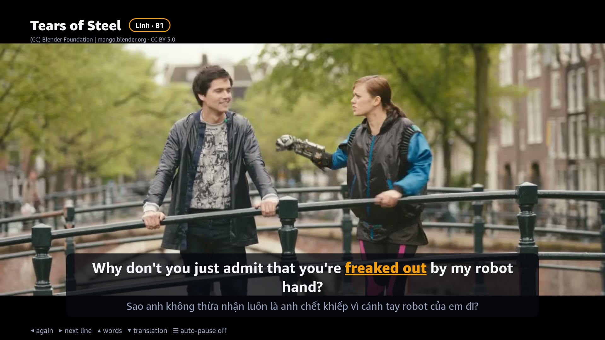 | 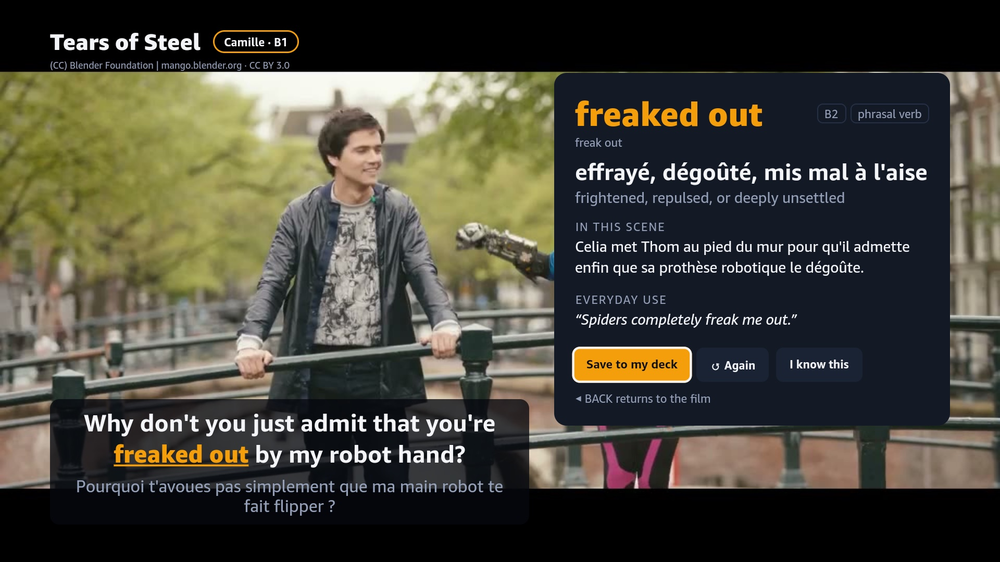 |
| **Learner subtitles.** New-for-you words are underlined in your colour. | **Word card.** ▲ then OK: the meaning *in this scene*, in your language. |
| 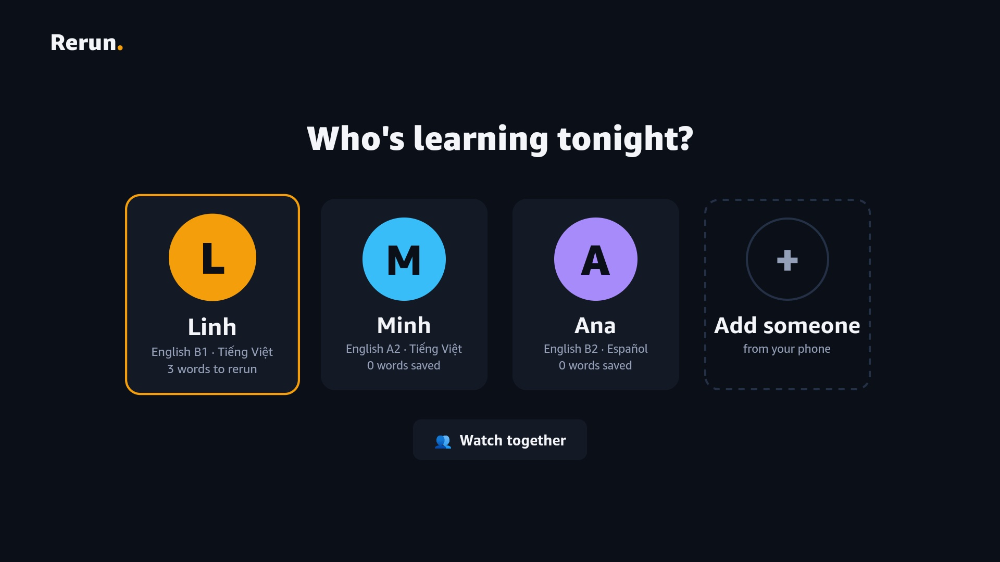 | 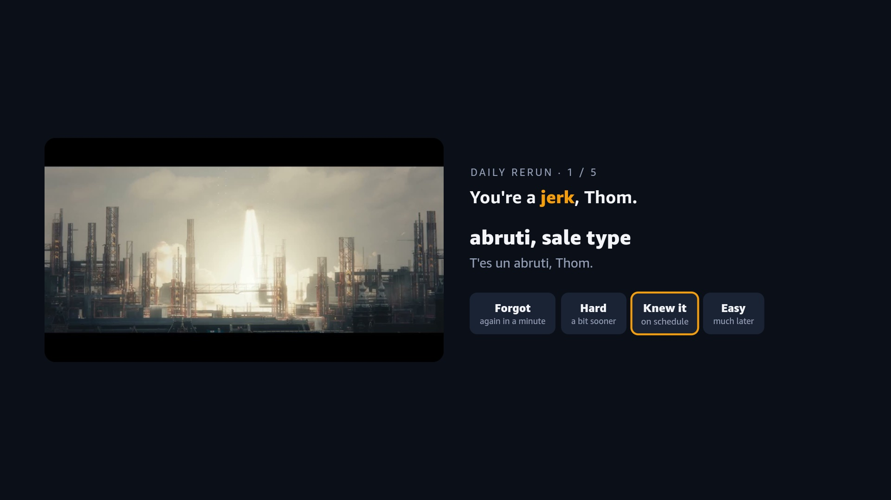 |
| **Who's learning tonight?** Each person has a language and a level. | **Daily Rerun.** Flashcards are film moments, graded with the D-pad. |

**Watching together.** Camille (B1, French), Hugo (A2, French) and Ana (B2, Spanish) watch one film. Each person's
new words carry their colour — "robotics" is new for Camille and Hugo, "awesome" only for Hugo — with a translation
line per language, and each word card saves to each person's own deck.

| | |
|---|---|
| 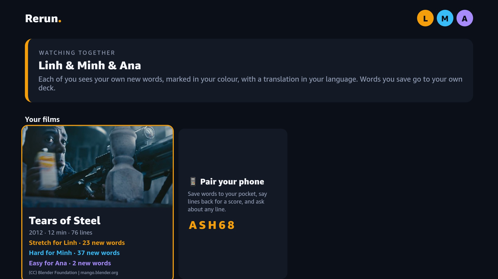 | 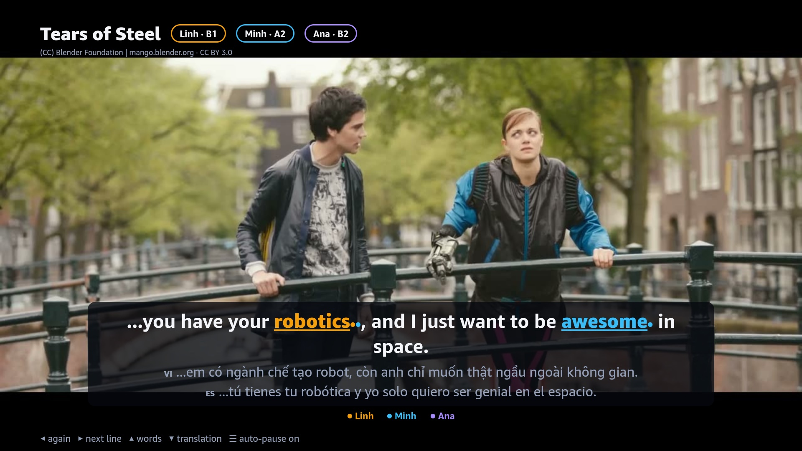 |

**Lines you hear again come back.** Every ◀ counts. A line you needed to hear twice returns in your Daily Rerun as a
listening card: the clip plays, the text stays hidden — *what did they say?* — until you ask for it.

| | |
|---|---|
| 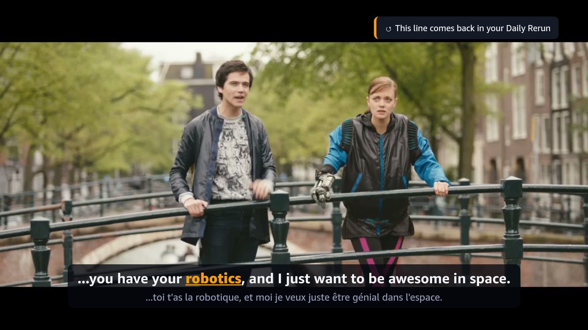 | 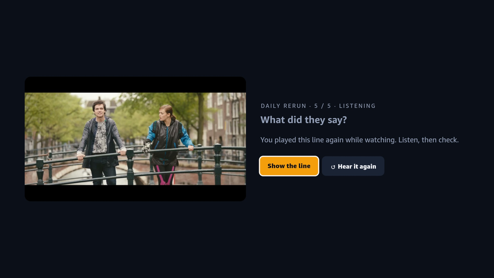 |

**Phone companion.** Scan the QR code on the TV — nothing to install. Say the line back and the TV shows your score;
a word saved on the TV is on the phone a second later.

| | |
|---|---|
| 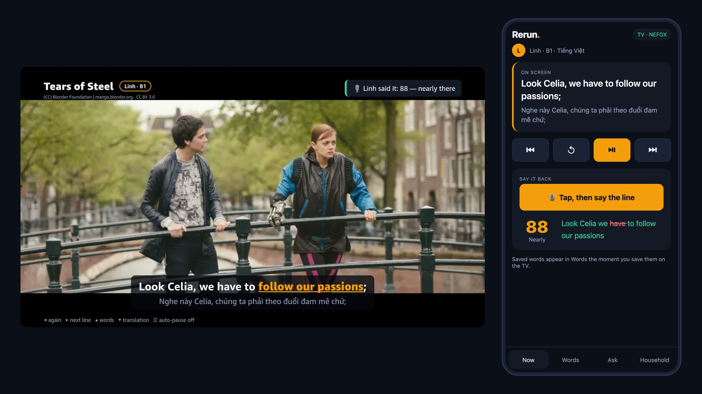 | 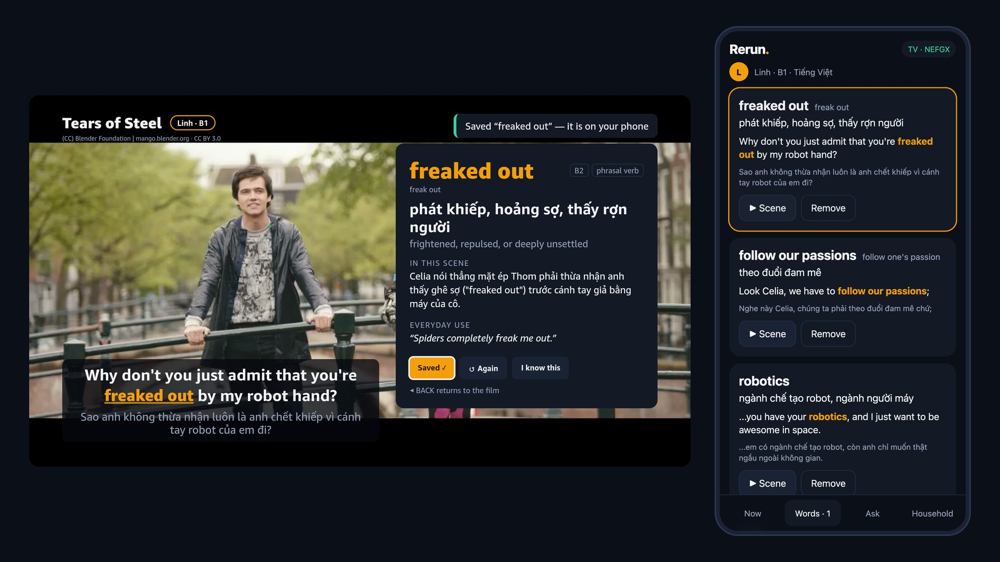 |

<sub>Screenshots from the Vega Virtual Device (Vega SDK 0.24), captured by `scripts/gallery.mjs`; phone screens from
`scripts/phone-sim.mjs`, which pairs a phone-sized Chrome with the TV (its speech input is simulated there; on a
phone the page uses the browser's speech recognition).</sub>

---

## Why

People learn languages from films — and they watch films on the TV. The tools that make a film a lesson
(interactive subtitles, click-a-word, replay-a-line) live in desktop browser extensions; on the TV you get a
pause button. Watching *with* the remote is the gap.

- **Five learners interviewed for Rerun** (October 2026) all watch films on a TV. Four skip at least three in four of
  the lines they don't understand, because pausing and looking words up breaks the film; three share the TV with
  someone at a different level; none keeps reviewing the words they do look up. *"Every time I pause to look up a bit
  of slang, my wife sighs: 'why is watching a film so exhausting?'"* — Tuấn D., 31, project manager (translated from
  Vietnamese).
- In Vietnam, where this was built, English proficiency is "moderate" (EF EPI 2025: 500/800, rank 64 of 123), and
  **listening (470) and speaking (461) are the weakest skills** — exactly what re-hearing a line and saying it back
  train.
- Fire TV has sold well over 250 million devices worldwide, and 22% of US residents speak a language other than
  English at home. Households share one TV but not one level of English.
- Subtitled viewing builds vocabulary (Peters & Webb, 2018), and spaced review makes it stick (Cepeda et al., 2006,
  across 317 experiments).

## What it does

| On the remote | While watching | |
|---|---|---|
| **◀** | Hear the line again (twice quickly: the line before) | It comes back in your Daily Rerun |
| **▶** | Jump to the next line | |
| **▲** | **Word mode**: the film pauses and the line's learnable expressions become stops | |
| **OK** on a word | A card: what it means here, in your language, plus an everyday example | Save it, or tell Rerun you know it |
| **▼** | Translation on/off | |
| **☰** | Auto-pause after every line | On by default for A1–A2 |

- **Who's learning tonight?** Each person in the household has a profile with their own language and level. The same
  film underlines different words for Camille (B1, French) and Hugo (A2, French), and the library shows how hard each
  film is *for that person*.
- **Watch together.** Pick several people: one film, everyone's own new words in their own colour, a translation line
  per language, and a save button per person. Auto-pause follows whoever finds the film hardest.
- **Phone companion, no install.** Scan the QR code on the TV. Saved words land on the phone instantly; say the line
  on screen back to the phone and get a word-by-word score on the TV; ask "is this rude?" about any line; add family
  members (typing on a phone beats typing with a remote).
- **Daily Rerun.** Spaced repetition on the TV: the clip plays, you recall the meaning, reveal it, and grade yourself
  with the D-pad. Words you master stop being highlighted. Lines you replayed while watching come back as listening
  cards, with the text hidden until you ask for it.

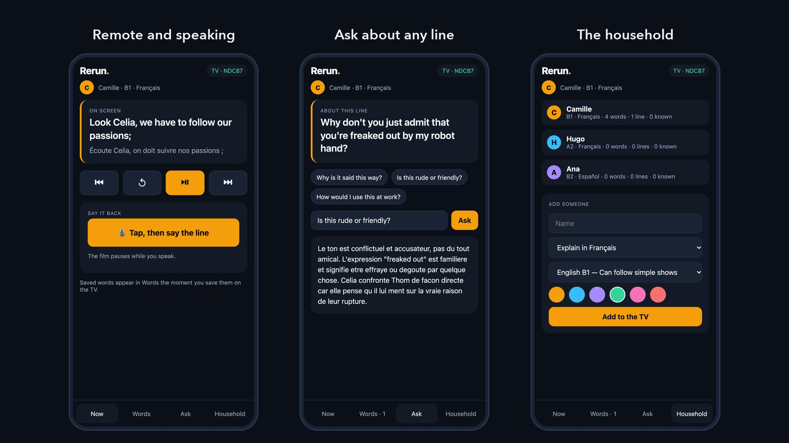

## How it is different

Lingopie has a Fire TV app with dual subtitles and tap-a-word on its own catalog, and Language Reactor brings
interactive subtitles to Netflix in a desktop browser. Rerun's take:

1. **In-context explanations, not dictionary entries.** Gemini reads the whole script first, so "freaked out" is
   explained as *Thom admitting he is scared of Celia's robot hand, half-joking* — in French, Spanish, German, Italian,
   Dutch, Polish, Portuguese, Indonesian or Vietnamese.
2. **Per-person, per-household.** Fire TV is a shared device; Rerun highlights what is new *for whoever is watching* —
   including several people at once, each in their own colour and language.
3. **Flashcards that are film moments**, reviewed on the TV with the D-pad.
4. **Listening and speaking**, not just reading: replay-a-line is the default key, the lines you replay become
   listening practice, and shadowing is scored.
5. **A layer, not a catalog.** The remote-first subtitle model is an open-source library any React Native TV app can
   use (see [Open source](#open-source)).

## How it works

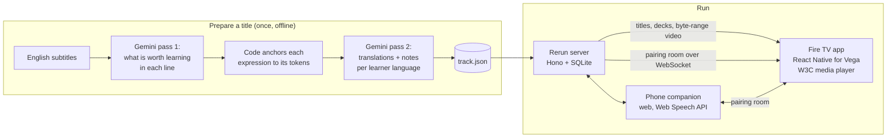

- **AI runs before you watch.** The pipeline (`pipeline/`) sends the full script to Gemini (`gemini-3.8-flash`; Claude works too) in two structured passes.
  The model *names* each expression; deterministic code finds it in the line's tokens and drops anything that is not
  there, so the TV never highlights a word that does not exist. Outputs are validated with zod and cached, and the
  prepared tracks are committed — playback never waits on a model, and the app runs without an API key.
- **Measured against humans.** The film ships with human subtitles in eight languages; `npm run eval` scores Rerun's
  translations against them with chrF, line by line, and lists the lines that disagree most for review. Tears of Steel,
  all 76 lines (`content/tears-of-steel/eval.json`):

  | es | it | de | fr | nl | pl | pt-PT | id |
  |---|---|---|---|---|---|---|---|
  | 72.2 | 70.0 | 69.8 | 65.4 | 64.2 | 61.6 | 52.4 | 51.7 |

  Most low-scoring lines are fair alternatives ("Ahí está." for *There she is.* against "Allí está ella.").
- **Remote first.** `packages/core` holds the pure logic — subtitle parsing, LEFT/RIGHT line navigation (with the
  "press twice for the line before" rule), the key map per player mode, per-learner difficulty, SM-2 scheduling and
  shadowing alignment — with unit tests. The TV app is a thin layer over it.
- **One player, many uses.** The Vega W3C media `VideoPlayer` plays the film; the Daily Rerun reuses it to play just
  the seconds of each card's line.

## Run it

Requirements: Node 22.13+, ffmpeg, and for the TV app the [Vega SDK](https://developer.amazon.com/docs/vega/0.24/install-vega-sdk.html)
(macOS on Apple Silicon or Ubuntu).

```bash
npm ci
scripts/prepare-media.sh tears-of-steel   # downloads the CC BY film, makes an MP4 and a poster
npm run build -w @rerun/phone             # the phone companion, served by the server at /m
npm run dev                               # Rerun server on :8787 with a demo household
```

The TV app and the Vega Virtual Device: see [docs/run-on-vega.md](docs/run-on-vega.md).

Phones need HTTPS for the microphone. On a home network, start the server with `HTTPS=1 npm run dev`: it also serves
on :8788 with a self-signed certificate for its LAN address, and the QR code on the TV points phones there (accept the
warning once). For a trusted certificate, put the server behind any HTTPS tunnel and set `PUBLIC_URL` instead.
No phone at hand: with `DEBUG_ROOMS=1`, `node scripts/phone-sim.mjs` opens a phone-sized Chrome window paired with
the TV.

Preparing a new title (needs `GEMINI_API_KEY` in `.env.local`, see `.env.example`):

```bash
npm run enrich -- tears-of-steel --langs vi,es,id,de,fr,it,nl,pl,pt-PT
npm run eval -- tears-of-steel
```

Tests: `npm test` (core, pipeline, server, phone). On the Vega Virtual Device, `node scripts/smoke-vvd.mjs` and
`node scripts/phone-sim.mjs --test` drive the real app with remote keys next to a phone (see
[docs/run-on-vega.md](docs/run-on-vega.md)).

## Repository

| Path | What |
|---|---|
| `apps/tv` | Fire TV app, React Native for Vega |
| `apps/phone` | Phone companion (Vite + React), served at `/m` |
| `apps/server` | API, decks, pairing rooms, byte-range video (Hono, `node:sqlite`, `ws`) |
| `packages/core` | Remote-first learning logic shared by all three, with tests |
| `pipeline` | Gemini enrichment (Claude optional) and translation evaluation |
| `content` | Titles: metadata, subtitles, prepared tracks |
| `docs` | Friction log, product feedback, Vega notes |

## Open source

`packages/core` and the learner subtitle component (`packages/react-native`) are released as a standalone library for
React Native TV apps: **[learner-subtitles](https://github.com/ZNLong2203/learner-subtitles)** — line navigation for a
D-pad, per-viewer word marking, SM-2 and shadowing scoring, with tests and a Vega example. Rerun builds it from this
repository with `scripts/export-oss.sh`, so the library is exactly the code Rerun runs. Rerun itself is Apache-2.0.

## Credits

*Tears of Steel* — (CC) Blender Foundation | mango.blender.org, licensed
[CC BY 3.0](https://creativecommons.org/licenses/by/3.0/). Reference subtitles in eight languages from the
Tears of Steel project. No other film content is included.
