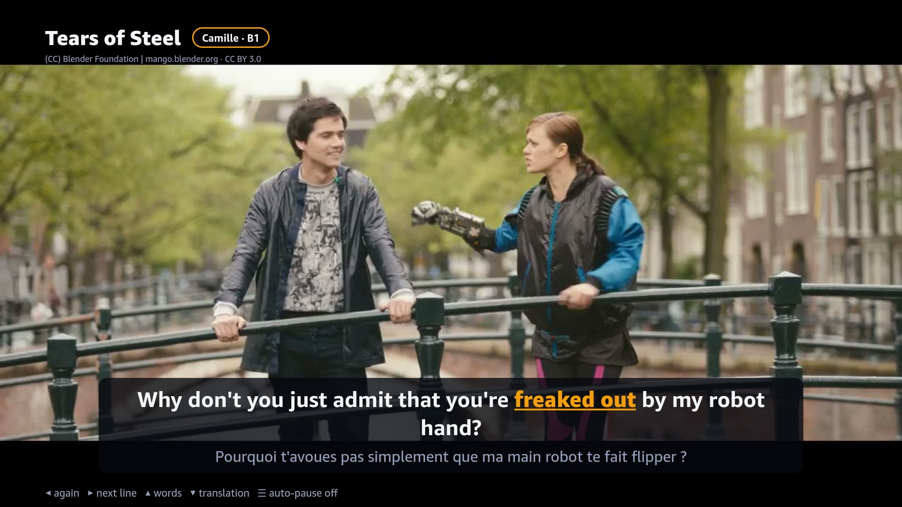
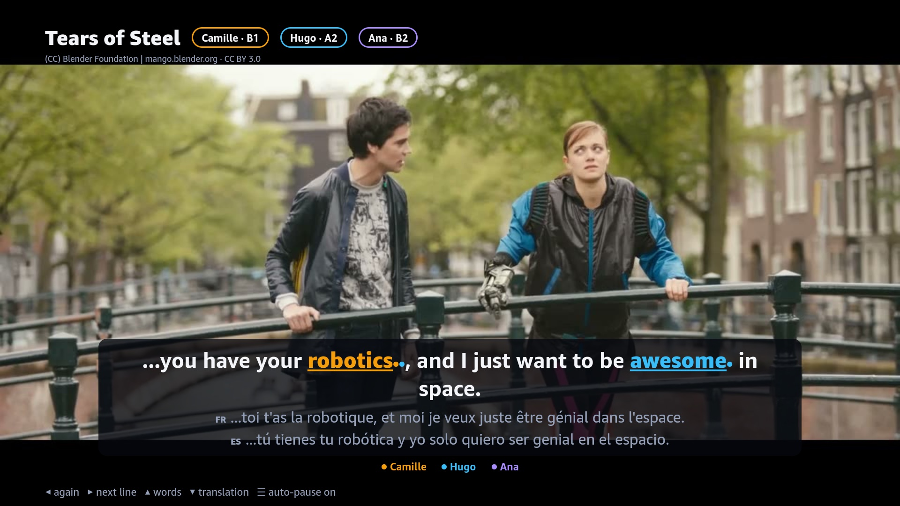

# learner-subtitles

**Remote-first language-learning subtitles for React Native TV apps.** Parse SRT or WebVTT, step through a film line
by line with a D-pad, mark the words that are new *for each person watching*, and review them later with spaced
repetition. Built for Vega OS (Fire TV); the component uses only React Native primitives, so it also runs on
react-native-tvos.

Extracted from [Rerun](https://github.com/ZNLong2203/rerun-tv), a Fire TV app that turns films into language lessons,
which uses this library for every subtitle you see:

| One learner | Three people watching together |
|---|---|
|  |  |

## Why

Interactive subtitles exist for desktop browsers. On a TV there is no mouse and no keyboard, only ◀ ▶ ▲ ▼ and OK — and
a TV is shared by a household whose members do not have the same level. This library is the part of that problem that
is not specific to any app:

- **Line navigation that matches how people re-listen.** ◀ restarts the line you are hearing; pressed again within
  1.2 s it goes to the line before (like "previous track"). ▶ goes to the next line. Auto-pause stops right after a line.
- **A key map per player mode** (`watch`, `words`, `card`) that leaves arrows and OK to the platform focus engine when
  a word or card is focused — and treats Vega's `"enter"` like `"select"`.
- **Per-viewer marking.** Given each viewer's CEFR level and known words, `newForViewers` says which expressions in a
  line are new for whom; the component draws one colour (and one dot) per person.
- **Tolerant parsing.** SRT and WebVTT, BOMs, CRLF, styling tags, `->` arrows, inverted or empty cues.
- **Learning loop.** An SM-2 scheduler (`review`, `sortForReview`) and an edit-distance shadowing scorer
  (`scoreShadowing`) that marks each word hit, missed or substituted.

Everything in `learner-subtitles` (the core) is pure TypeScript with no dependencies and is unit-tested; the React
Native component is in `learner-subtitles/react-native`.

## Use

```ts
import { parseSubtitles, cueIndexAt, commandFor, previousLineTarget, newForViewers } from "learner-subtitles";
import { LearnerSubtitles } from "learner-subtitles/react-native";

const cues = parseSubtitles(srtText); // [{ id, start, end, text }]
const index = cueIndexAt(cues, player.currentTime); // the line on screen, or -1

// In your TV key handler:
const cmd = commandFor(mode, evt.eventType); // { type: "previousLine" } | { type: "toggle" } | …
if (cmd.type === "previousLine") player.currentTime = previousLineTarget(cues, player.currentTime)!.start;
```

```tsx
<LearnerSubtitles
  cue={track.cues[index]}
  viewers={[
    { id: "camille", name: "Camille", color: "#F59E0B", level: "B1", known: camilleKnows },
    { id: "hugo", name: "Hugo", color: "#38BDF8", level: "A2", known: hugoKnows },
  ]}
  langs={["fr"]}
  wordMode={mode === "words"}
  onSelectItem={(item) => openCard(item)}
  theme={{ fontSize: 23 }}
/>
```

`track` is an `EnrichedTrack`: cues plus, for each line, translations and the learnable items (an expression, its
token range, CEFR level, meaning and in-context note per language). Rerun produces these with an LLM pipeline and
anchors every expression to the line's tokens with `locatePhrase`, so a renderer never highlights a word that is not
there.

A complete Vega example with the W3C media player is in [`examples/VegaPlayer.tsx`](examples/VegaPlayer.tsx).

## Vega notes

Learned the hard way while building Rerun (details in its
[friction log](https://github.com/ZNLong2203/rerun-tv/blob/main/docs/friction-log.md)):

- Import `useTVEventHandler` and `BackHandler` from `@amazon-devices/react-native-kepler`, and declare
  `com.amazon.inputd.service` in `manifest.toml`, or remote events never arrive.
- Memoise the handler you pass to `useTVEventHandler`; it re-subscribes whenever the function changes.
- The URL-mode player rejects cleartext HTTP and paths without an extension: serve `https://…/film.mp4`.
- Layout units on a 1080p Vega TV are 960 wide; the default theme is sized for that.

## API

| Module | Exports |
|---|---|
| subtitles | `parseSubtitles`, `toWebVtt`, `stripMarkup`, `Cue` |
| tokenize | `tokenize`, `detokenize`, `locatePhrase`, `Token` |
| navigation | `cueIndexAt`, `lastStartedCueIndex`, `previousLineTarget`, `nextLineTarget`, `cueEndedBetween` |
| remote | `commandFor`, `PlayerMode`, `PlayerCommand`, `RemoteKey` |
| learning | `isNewFor`, `newForViewers`, `trackDifficulty`, `segmentLine`, `viewerLanguages`, `shouldAutoPause`, `EnrichedTrack` |
| srs | `newCard`, `review`, `isDue`, `isMastered`, `sortForReview` |
| shadowing | `scoreShadowing` |
| protocol | `RoomMessage`, `parseRoomMessage`, `isPairCode` — messages for a phone companion paired by code (optional); `CardView` (a saved word, or a line to hear again) and `lineItemId` |
| react-native | `LearnerSubtitles`, `FocusChip`, `defaultTheme`, `SubtitleTheme` |

## Develop

```bash
npm install
npm test          # vitest
npm run typecheck
```

## License

Apache-2.0. Screenshots show *Tears of Steel*, (CC) Blender Foundation | mango.blender.org, CC BY 3.0.
